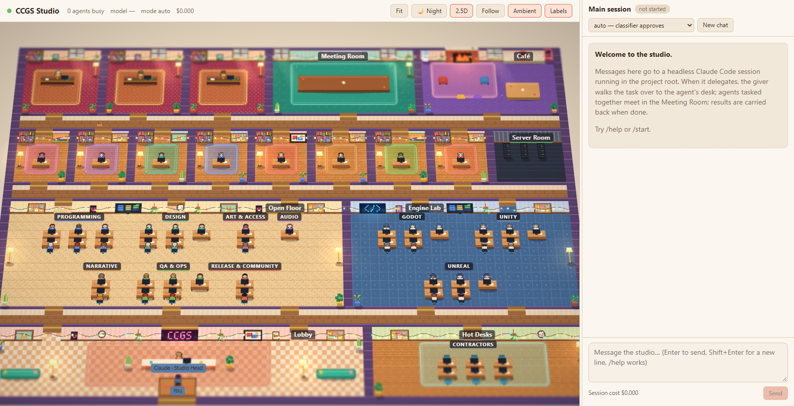
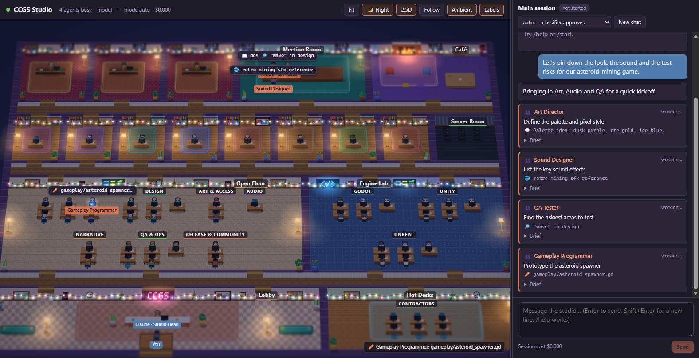
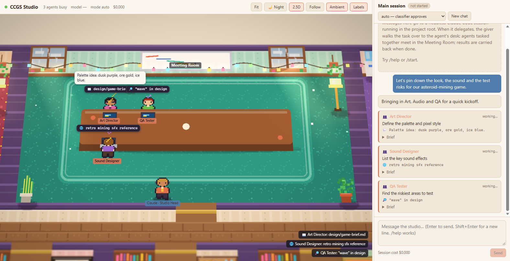
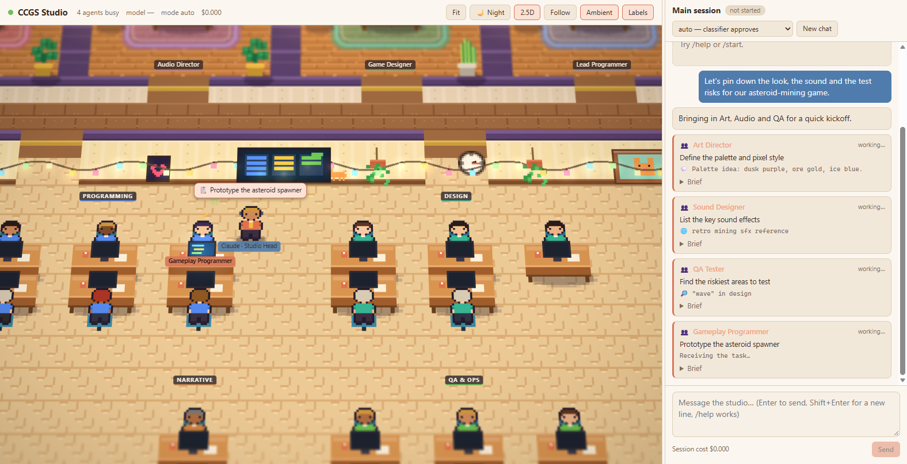
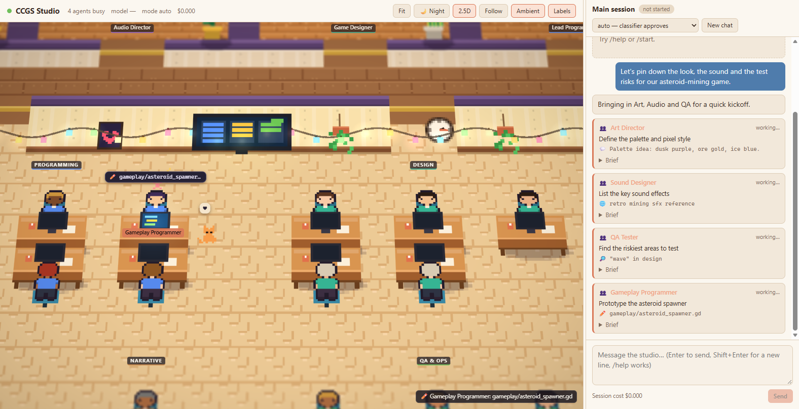
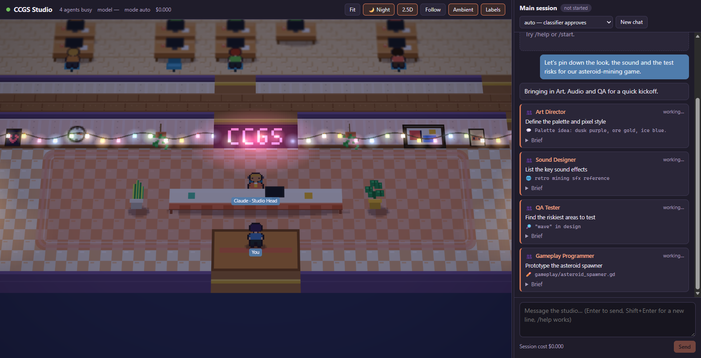

# CCGS Studio Viewer

A 2D pixel-art studio that shows the CCGS agents at work, with the main
Claude Code session chat beside it.

- **Left:** the studio floor. Directors have corner offices, leads have
  private offices, and specialists sit at department pods on the open floor or
  in the Engine Lab. Built-in agents such as `Explore` arrive as contractors and
  use the hot desks.
- **Right:** your chat with the main session. Messages go to a headless
  `claude` process running in the project root.

## Screenshots

| | |
|---|---|
|  |  |
| The whole studio by day, before any work starts | The same studio at night, with four agents busy |
|  |  |
| Three agents tasked together meet and work at the table | Claude walks a task over to the Gameplay Programmer |
|  |  |
| A working agent: typing, lit monitor, live tool chip | The lobby at night: neon sign, fairy lights, Claude at reception |

These screenshots were staged by replaying studio events in the page, not
taken from a real Claude session, so no tokens were spent on them. A real
session drives exactly the same animations.

## Run it

```bash
cd tools/studio-viewer
npm install
npm run studio
```

Open <http://localhost:5317>. Requirements: Node 22+, and the `claude` CLI on
`PATH` and logged in. The viewer reuses that login, so no API key is needed.

| Variable | Default | Effect |
|---|---|---|
| `STUDIO_PORT` | `5317` | Port the viewer listens on (localhost only) |
| `STUDIO_MODEL` | Claude Code's default | Model passed to `claude --model` |
| `CLAUDE_BIN` | found on `PATH` | Path to the `claude` executable |
| `CCGS_ROOT` | `../..` | Project the session runs in |
| `STUDIO_STATE_DIR` | `.studio` | Where the conversation id, chat history and `stream.log` are kept |

Run one server per state directory. Two servers sharing `.studio/` overwrite
each other's chat history. Point a second one at its own `STUDIO_STATE_DIR`.

## What you see

| Happening in the session | In the studio |
|---|---|
| The main session thinks, writes or uses a tool | Claude, the Studio Head at the lobby desk, types, with a thought bubble, speech bubble or tool chip |
| Claude (or an agent) gives one agent a task | The **giver walks to the receiver's desk** and a 📄 document flies over. The receiver says "On it!" and the giver walks back |
| A second task follows from the same giver within `dispatchQuietMs` | The giver calls a **meeting**: the delivery is cancelled, everyone walks to the Meeting Room, the giver gives a kickoff and hands out documents, and each agent says what it will take. Agents **stay at the table and work** there. Later tasks in the same dispatch **join** the meeting |
| An agent messages another agent (`SendMessage`) | Both sit down in the Meeting Room and talk |
| An agent is working | Typing (back-view agents bob), glowing monitor or laptop at the table, rising `{ } < > #` glyphs, an orange name tag, and a tool chip (📖 ✏️ ⌨️ 🔎 🌐) that stays until the next action |
| An agent finishes | It brings a ✅ document with its real result to whoever gave the task. If the giver is still at the meeting table, it hands it over there |
| Nobody needs an agent | It idles. With **Ambient** on, idle agents get coffee, chat at the water cooler or sit in the lounge; those bubbles are dimmed |

When something looks wrong, `.studio/stream.log` holds the raw Claude Code
stream (rotated at 5 MB), so you can compare what Claude sent with what the
studio showed.

Look and feel:

- The studio is a small, warm pixel-art office: director and lead offices,
  a Meeting Room, a Café with a crackling fireplace, armchairs and beanbags,
  an open floor, the Engine Lab, a Lobby and Hot Desks. Fairy lights run
  along the walls, rain streaks the windows, and there are rugs, hanging
  plants, lamps and posters everywhere.
- A studio cat wanders around: it naps on rugs and by the fire, and goes
  to sit next to agents who are working. Click it.
- **🌙 Night** switches the studio to night: deep blue shade, starry
  windows, glowing lamps, fairy lights, fire and monitors. The interface
  switches with it (light theme by day, dark theme by night). The choice is
  remembered. The first visit follows the system's dark-mode setting.
- **2.5D** tilts the floor back like a miniature diorama and adds tilt-shift
  blur at the top and bottom edges. Turn it off for a flat, fully sharp view.
- Every look setting lives in the `visuals` block of `studio-config.json`:
  tilt angle, perspective, blur radius and sharp band (`tiltShift`),
  saturation, vignette, sun beams, lamp glow, `rain`, the day warmth tint,
  and the night shade colour and strength (`nightShadeAlpha`,
  `nightGlowBoost`). The server re-reads the file on each page load, so after editing
  a value just refresh the browser.

Interaction:

- Drag to pan and scroll to zoom.
- Click an agent to open its card: role, model, current tasks with their full
  brief, and recent activity.
- **Ask in chat** prefills `Use the <agent> agent to …`.
- Click an agent's name in the chat to find it on the floor.

## Permission mode

Headless Claude cannot show terminal permission prompts, so pick a mode in the
chat header: `auto`, `acceptEdits`, `plan`, `manual`, `dontAsk` or
`bypassPermissions`. Changing the mode stops the current process, and the
next message resumes the same conversation in the new mode. Deny rules in
`.claude/settings.json` still apply under every mode.

If the header shows `⚠` next to the mode, Claude reported a different mode
from the one requested. A common cause is a workspace that has never been
trusted. To fix it, run `claude` once interactively in the project root and
accept the trust prompt. Until then, Claude also ignores `permissions.allow`
entries.

`AskUserQuestion` is turned off for this session, so Claude asks its
questions in plain text in the chat.

## Layout

```
server/   Node server: spawns claude (stream-json), maps its output to studio events, WebSocket hub
shared/   Protocol types and tool summaries used by both sides
client/   Vite + Phaser 3 front end: studio scene, choreography, chat, inspector
tests/    Vitest unit tests (npm test)
studio-config.json   Departments, colours and animation timing (data, not code)
```

The conversation id and chat history are kept in `.studio/session.json`
(gitignored), so restarting the server resumes the same conversation. Use
**New chat** to start over.

## Checks

```bash
npm test          # event mapping, layout reachability, pathfinding, roster parsing, sprites
npm run typecheck
```
